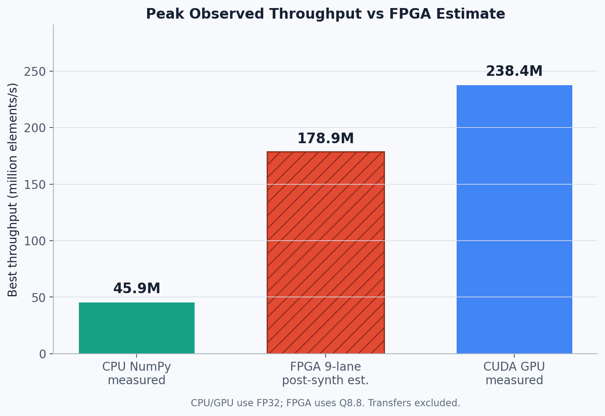
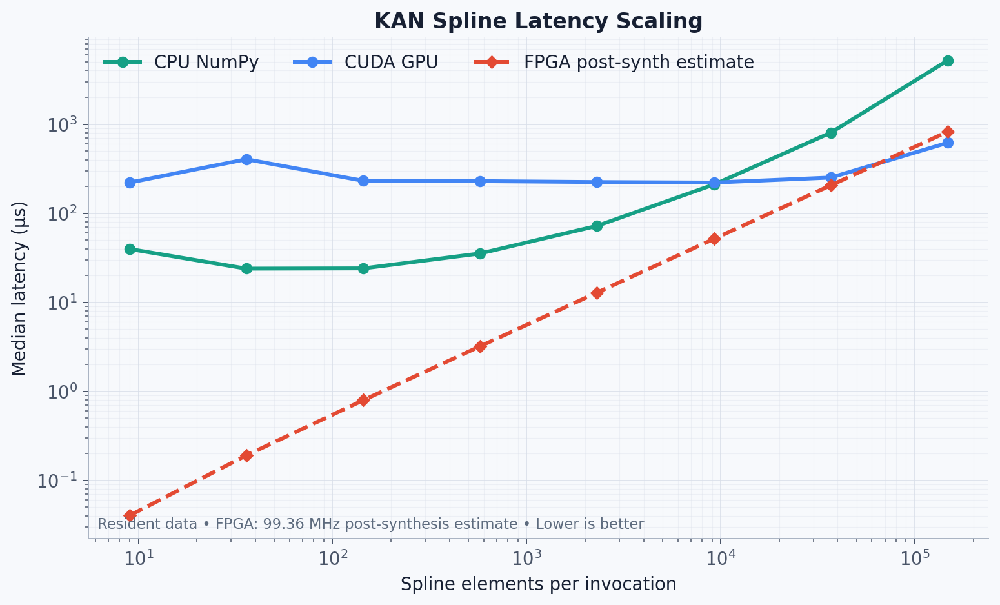
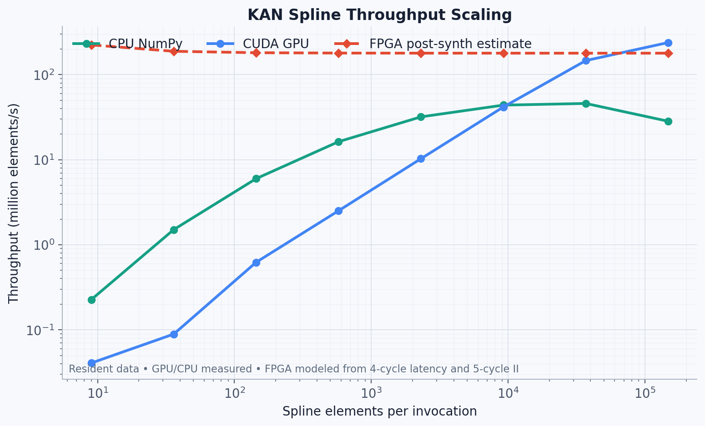
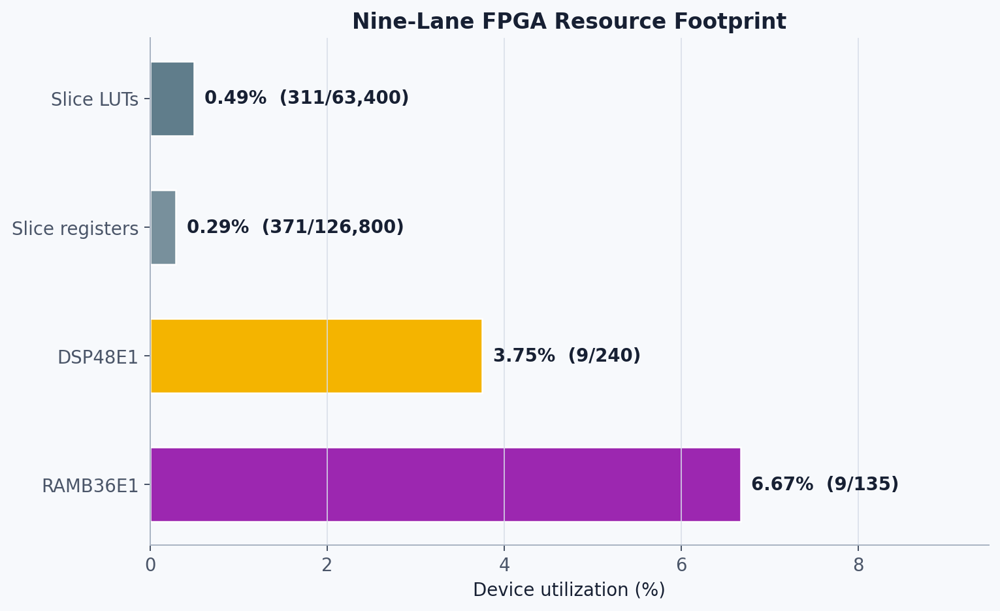

# KANPIM

Conducted a roofline experiment. And realized PIM is excellent for Kolmogorov-Arnold Networks.
The timed reports are the final ones.

## Why FPGA?

The main advantage of this accelerator is low latency for small and medium spline workloads.

For one nine-element spline invocation:

| Platform | Latency |
|---|---:|
| Nine-lane FPGA | 40.26 ns estimated |
| NumPy CPU | 39.70 µs measured |
| PyTorch CUDA | 221.22 µs measured |

For this specific small workload, the FPGA provides:

- Approximately 986× lower projected latency than NumPy
- Approximately 5,495× lower projected latency than the PyTorch CUDA baseline

The GPU baseline uses standard, non-fused PyTorch operations. Therefore, these results demonstrate the benefit of specialized hardware over a general software implementation for small workloads. They do not imply that the FPGA is faster than every possible optimized GPU implementation.

## Batch-size crossover

The FPGA remains latency-competitive as the workload increases:

| Elements | CPU | GPU | FPGA estimate |
|---:|---:|---:|---:|
| 9 | 39.70 µs | 221.22 µs | 0.040 µs |
| 36,864 | 803.88 µs | 251.90 µs | 206.10 µs |
| 147,456 | 5,203.41 µs | 618.46 µs | 824.43 µs |

The FPGA performs best for latency-sensitive small and medium workloads. The GPU becomes faster at large batch sizes because it can amortize launch overhead and use more parallel hardware.

## FPGA resource efficiency

The nine-lane accelerator uses:

| Resource | Used | Available | Utilization |
|---|---:|---:|---:|
| Slice LUTs | 311 | 63,400 | 0.49% |
| Registers | 371 | 126,800 | 0.29% |
| DSP48E1 blocks | 9 | 240 | 3.75% |
| RAMB36E1 blocks | 9 | 135 | 6.67% |

At the post-synthesis frequency estimate of 99.36 MHz, the design provides:

- 178.86 million spline evaluations per second
- 19.87 million spline evaluations per second per DSP
- Approximately 575,000 spline evaluations per second per LUT
- 40.26 ns latency for one nine-element transaction

## Measurement limitations

- FPGA performance is based on clock-constrained post-synthesis timing.
- The design narrowly misses the 100 MHz constraint by 0.064 ns.
- Placement, routing, and physical board measurements have not yet been completed.
- CPU and GPU results use FP32 arithmetic.
- The FPGA uses signed Q8.8 fixed-point arithmetic.
- CPU and GPU measurements exclude data-transfer time.
- FPGA estimates assume resident coefficients and uninterrupted input delivery.
- No power-efficiency claim is made yet. This requires routed FPGA power analysis and matched GPU power measurements.
## Benchmark snapshot

The accelerator evaluates nine piecewise-cubic spline elements in parallel using nine DSP48E1 blocks and nine on-chip coefficient-memory banks.

CPU and GPU values are measured in Colab with resident data. FPGA performance is a post-synthesis estimate at 99.36 MHz. CPU/GPU use FP32; FPGA uses signed Q8.8.

### Scaling behavior

### FPGA resource utilization

| Metric | Result |
|---|---:|
| FPGA post-synthesis frequency estimate | 99.36 MHz |
| Nine-element FPGA latency estimate | 40.26 ns |
| FPGA steady-state throughput estimate | 178.86 M elements/s |
| Best measured CPU throughput | 45.86 M elements/s |
| Best measured GPU throughput | 238.42 M elements/s |
| FPGA resources | 311 LUTs, 371 registers, 9 DSPs, 9 RAMB36E1 |

> **Status:** The FPGA figures are clock-constrained post-synthesis estimates, not routed or board-measured results. The 100 MHz constraint missed by 0.064 ns. CPU/GPU measurements exclude host-device transfers.
